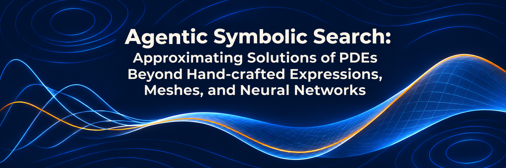
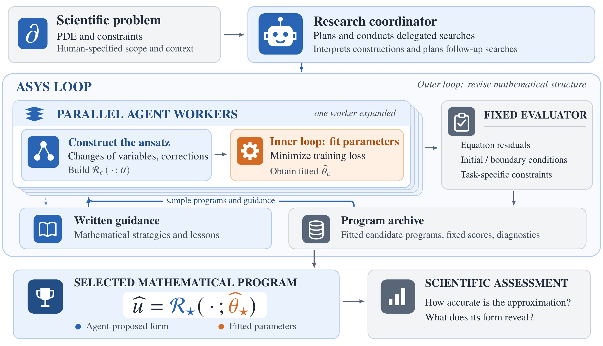

<p align="center">
  
</p>

# Agentic Symbolic Search (ASYS)

ASYS constructs explicit mathematical approximations to nonlinear partial
differential equations from supplied mathematical starting points. Agents revise
the form of a candidate solution—its coordinates, branches and correction
terms—and fit its coefficients against the equation and prescribed constraints.
A fixed evaluator scores the resulting constructions; programs and written
guidance inform subsequent proposals.

Use ASYS to study your own problems by supplying the equation, constraints,
starting program and evaluation criteria. A coordinator defines tasks and starting
context, examines returned constructions, and decides when to stop or continue a
search. The paper demonstrates the system on concentrating fields, algebraic
tails, boundary responses and interacting interfaces.



## Saved manuscript constructions

The paper's returned expressions, fitted coefficient states and comparison
models are packaged in [`experiments/`](experiments/README.md). Its index links
directly to model sources and saved states, with study READMEs explaining how to
assess them without launching a new search.
Allen–Cahn and transient Fujita also include the paper's neural comparison
baselines in their `neural/` directories; their ASYS constructions are in
`selected/`.

## Search setups

This release contains ten scientific setups under `configs/eve/`. Each includes
its starting application, evaluator, worker instructions and initial guidance.
Numerical assessment references are generated separately; additional baseline
implementations are under [`baseline/`](baseline/).

| Experiment | Config name |
| --- | --- |
| Real-line gCLM similarity profile and algebraic tail | `asys-gclm-profile` |
| Transient radial Fujita field | `asys-fujita-ivp` |
| Periodic NLS and width transfer | `nonlinear-schrodinger` |
| Allen–Cahn coupled interface modes | `asys-pinn-allen-cahn-2d` |
| Keller–Segel concentrating radial density | `keller-segel-radial-2d` |
| Conditional porous-medium waiting profile | `graveleau-waiting-profile` |
| Stationary radial Fujita profile | `asys-fujita-stationary` |
| Allen–Cahn geometric fields | `allen-cahn` |
| Radial porous-medium focusing and its similarity-profile component | `asys-blowup-graveleau-pme-2d` |
| Hamilton–Jacobi coefficient inference | `asys-hj-inverse` |

Proposed candidates use explicit representations. Neural surrogates, stored
solution tables and numerical equation solvers are excluded from proposals.
Numerical coefficient fitting, quadrature, differentiation and fixed scoring
remain part of the scientific workflow. Each task's immutable instructions give
its equation, domain, interfaces and constraints.

Forward searches score equations and prescribed constraints. HJ additionally
uses the supplied noisy observation packet. Stationary Fujita includes an
agent-based symbolic admission step before numerical evaluation.

## Setup and running

Use Python 3.11–3.14, [uv](https://docs.astral.sh/uv/), Git, Bash and GNU
command-line utilities (`time`, `timeout`, `find`, `sort`, `xargs`, `sha256sum`
and `cmp`). From the repository root, install the Python dependencies:

```bash
uv sync
export ASYS_PYTHON="$PWD/.venv/bin/python"
```

The default agent driver uses Codex with `gpt-6.1-sol` and extra-high reasoning.
Install and authenticate Codex before launching a search. For Codex versions
using hooks, initialize and trust the EvE hooks:

```bash
uv run python -m scaling_evolve.providers.agent.codex_hooks
codex
# /hooks → trust the EvE hooks
```

Run the radial Fujita experiment, or substitute any config name from the table:

```bash
uv run python -m scaling_evolve.algorithms.eve.runner --config-name=asys-fujita-ivp
```

Set the search ceiling and workers per iteration with command-line overrides:

```bash
uv run python -m scaling_evolve.algorithms.eve.runner \
  --config-name=asys-fujita-ivp loop.max_iterations=20 loop.n_workers_phase2=2
```

Search iterations are batches of worker attempts, distinct from numerical
fitting steps. Searches invoke paid agent services through your configured
account. Numerical fitting and evaluation run on CPU; W&B logging is disabled
by default.

## Assessment references

Generate numerical field/profile references separately from search:

```bash
export ASYS_PYTHON="$PWD/.venv/bin/python"
scripts/prepare_references.sh --check
scripts/prepare_references.sh fujita
scripts/prepare_references.sh nls
scripts/prepare_references.sh allen-cahn
scripts/prepare_references.sh allen-cahn-geometric
scripts/prepare_references.sh gclm
```

The script reuses the existing finite-volume, spectral and integral-reference
solvers. It stores outputs under `references/`, verifies checksums before reuse,
and preserves incomplete outputs. Pass another output directory as the second
argument. Full reference generation can take hours and several GB of storage;
the small `--check` fixtures do not generate the full banks. Keep assessment
references outside solver workspaces and fitting objectives.

## Baselines

The original [SIGS and FEX gCLM searches](baseline/gclm/README.md) and
[earlier Allen–Cahn hard-jet control](baseline/allen_cahn/README.md) are under
`baseline/`. Install their dependencies with `uv sync --extra baseline`.
SIGS additionally requires the pinned assets fetched by
`baseline/gclm/sigs_upstream/fetch_assets.sh`.

## EvE framework and attribution

ASYS uses Evolving Ensemble of Agents (EvE) to run workers and retain candidate
programs and written guidance.

See [using EvE](docs/using-eve.md) for run management and [code structure](docs/structure.md)
for the runtime layout. The circle-packing configuration is the framework smoke
test. Run offline tests with `uv run pytest -m 'not live'`.

EvE is developed by the Scientific Computing and Intelligence Group at the
National University of Singapore. Preserve the included [NOTICE](NOTICE) and
[LICENSE](LICENSE) with redistributed code.
